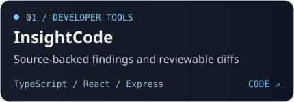
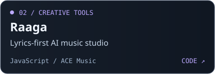
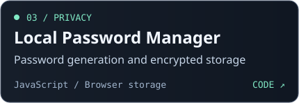
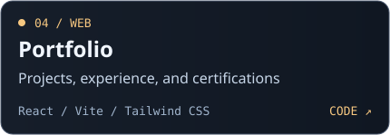

[**Portfolio**](https://ayushgupta-portfolio.vercel.app/) · [LinkedIn](https://www.linkedin.com/in/ayush-gupta456/) · [Email](mailto:omayush456.ag@gmail.com)

I build web apps across the stack, from React interfaces to APIs, authentication, and database design. My projects include a code review workspace with source-backed findings and a music studio that starts with lyrics.

## Tech stack

| Area | Stack |
| --- | --- |
| **Languages** | `TypeScript` `JavaScript` `Java` `SQL` |
| **Frontend** | `React` `Vite` `Tailwind CSS` `HTML` `CSS` |
| **Backend** | `Node.js` `Express` `REST APIs` |
| **Databases** | `MongoDB` `PostgreSQL` |
| **Tools** | `Git` `GitHub` `Postman` `Vercel` |

## Selected projects

  
  
  
  

[Try InsightCode](https://insightcode.vercel.app/) · [Explore all repositories](https://github.com/ayush-gupta456?tab=repositories)

## Contribution activity

[Open my GitHub contribution calendar →](https://github.com/ayush-gupta456#contribution-graph)

## Let’s build something together

Have a project in mind or want to talk about developer tooling? [Send me an email](mailto:omayush456.ag@gmail.com) or [connect on LinkedIn](https://www.linkedin.com/in/ayush-gupta456/).
